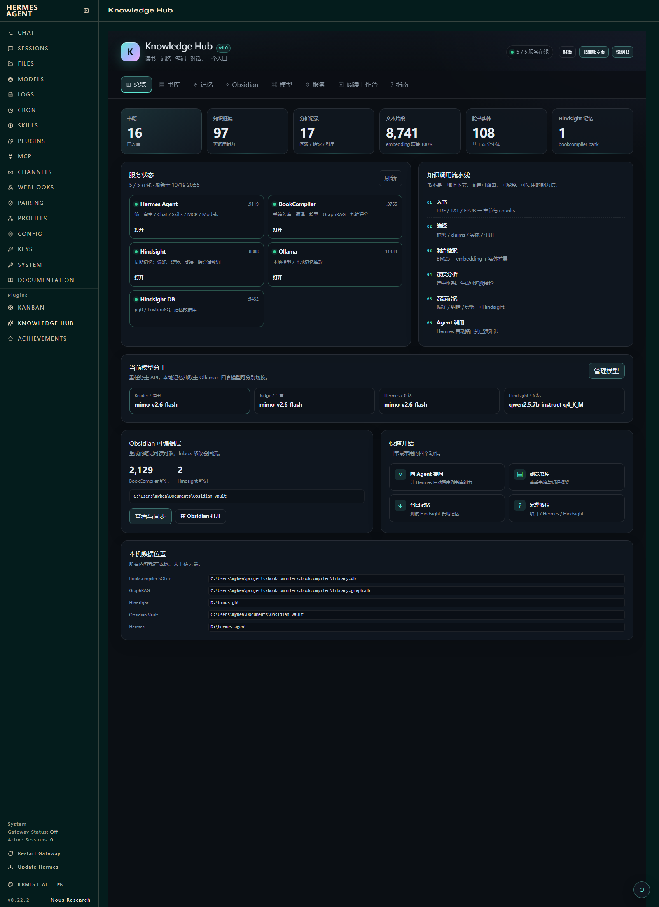
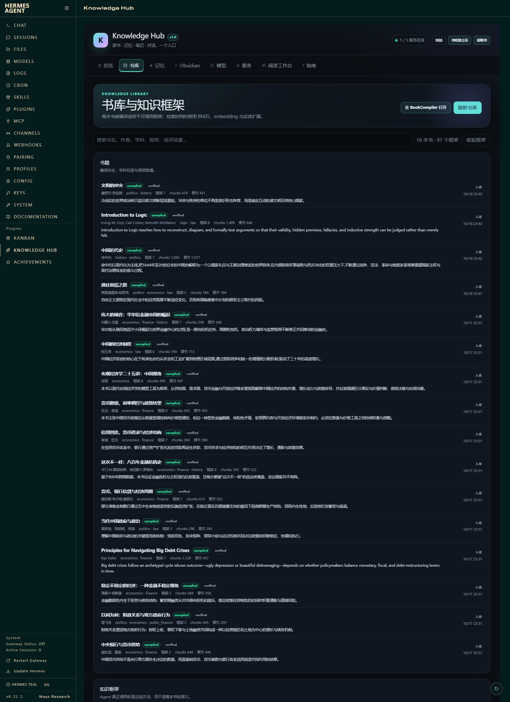
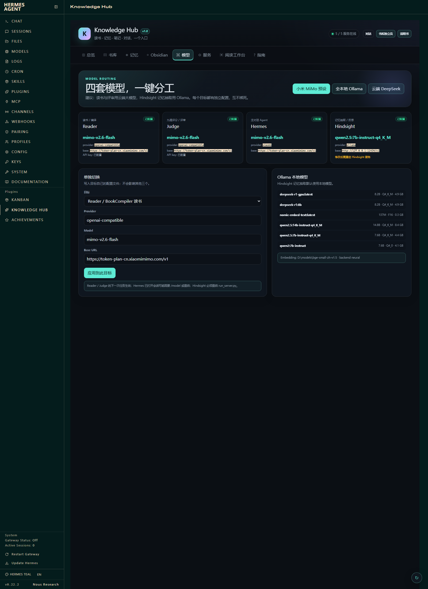
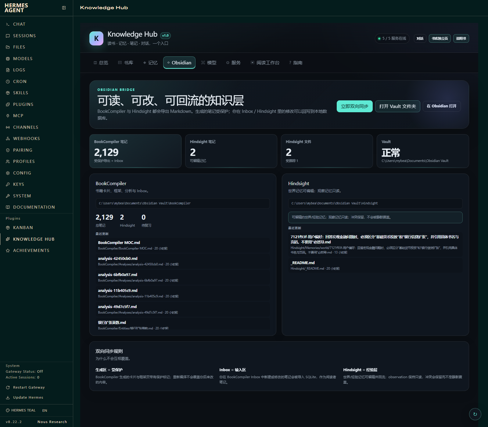
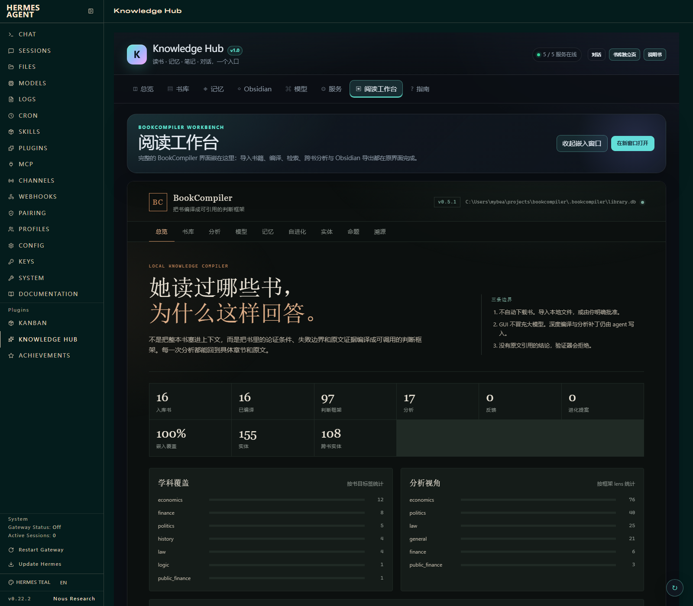

# Knowledge Hub

把 **Hermes Agent / BookCompiler / Hindsight / Obsidian** 收进一个统一控制台的本地知识系统。

> 不是把四个项目揉成一份代码，而是：
> **Hermes 作为统一宿主 + Knowledge Hub 作为统一控制台 + BookCompiler 能力层 + Hindsight 经验层 + Obsidian 人类可编辑层。**

## 代码仓库

- GitHub: https://github.com/Josephdunkey/whateverthisismaybefunny
- 部署插件: `powershell -File D:\knowledge-hub\tools\deploy-plugin.ps1`

## 这几天的工作快照

- `projects/bookcompiler/` — BookCompiler 源码、文档、技能包、测试
- `projects/hermes/` — Hermes 配置样例、启动脚本、book-library / book-learning-loop 技能
- `projects/hindsight/` — Hindsight 部署与对接脚本、`.env.example`
- `hermes-plugin/` — 统一 GUI 的 Hermes Dashboard 插件
- 安全边界：仓库不包含 `.env`、`auth.json`、`state.db`、数据库、模型文件和运行日志。
## 一键启动

双击：

```text
D:\knowledge-hub\start-knowledge-hub.bat
```

它会依次检查并启动：Ollama → PostgreSQL（pg0）→ Hindsight → BookCompiler → Hermes Dashboard，已经在跑的服务不会重复启动。

启动后打开统一入口：

```text
http://127.0.0.1:9119/knowledge-hub
```

## 停止

```text
D:\knowledge-hub\stop-knowledge-hub.bat
```

默认停止 BookCompiler、Hindsight、Hermes Dashboard；PostgreSQL 和 Ollama 保持运行。要全部停止：

```powershell
python D:\knowledge-hub\tools\stop.py all
```

## 八个页面

| 页面 | 能做什么 |
|---|---|
| 总览 | 5 个服务状态、书库规模、知识流水线、模型分工、数据位置 |
| 书库 | 搜索 16 本书、97 个知识框架、最近分析 |
| 记忆 | 切换 Hindsight bank、Recall / Reflect、写入长期记忆 |
| Obsidian | Vault 状态、2,129 篇 BookCompiler 笔记、导出与人工回流 |
| 模型 | Reader / Judge / Hermes / Hindsight 四槽独立切换，内置 MiMo / 全本地 / DeepSeek 预设 |
| 服务 | 启停服务、打开 Hermes 原生页面、打开目录、看日志 |
| 阅读工作台 | 嵌入完整 BookCompiler GUI；被拦截时可新窗口打开 |
| 指南 | 四系统关系、每天怎么用、三种调用模式、常见问题 |

## 目录结构

```text
D:\knowledge-hub\
  start-knowledge-hub.bat   # 一键启动
  stop-knowledge-hub.bat    # 停止主要服务
  tools\launch.py           # 启动器
  tools\stop.py             # 停止器
  tools\build-dashboard.ps1 # 重新合并前端分块并做语法检查
  src\dashboard-chunks\     # 前端源码分块 01.js → 10.js
  config\ecosystem.json     # 服务与路径配置
  docs\manual.html          # 完整图文教程
  hermes-plugin\           # Hermes Dashboard 插件副本（可直接提交到 GitHub）
  tools\deploy-plugin.ps1  # 把 hermes-plugin 部署到 Hermes
  logs\                     # stdout / stderr
```

Hermes 插件本体：

```text
D:\hermes agent\plugins\knowledge-hub\
  dashboard\manifest.json
  dashboard\plugin_api.py
  dashboard\manual.html
  dashboard\dist\index.js
  dashboard\dist\style.css
```

## 服务地址

| 服务 | 地址 |
|---|---|
| Knowledge Hub | http://127.0.0.1:9119/knowledge-hub |
| Hermes Dashboard | http://127.0.0.1:9119 |
| BookCompiler | http://127.0.0.1:8765 |
| Hindsight | http://127.0.0.1:8888 |
| Ollama | http://127.0.0.1:11434 |

## 数据在哪里

| 内容 | 位置 |
|---|---|
| 书库数据库 | `C:\Users\mybea\projects\bookcompiler\.bookcompiler\library.db` |
| GraphRAG 图库 | `C:\Users\mybea\projects\bookcompiler\.bookcompiler\library.graph.db` |
| Hindsight 记忆 | PostgreSQL / pg0，`127.0.0.1:5432` |
| 人类可读笔记 | `C:\Users\mybea\Documents\Obsidian Vault` |
| 知识源书 | `D:\fanshu` |
| 运行日志 | `D:\knowledge-hub\logs` |

所有数据都在本机。只有调用云端模型时，发送的是当次需要的文本片段，不上传整个书库。

## 模型分工

- **Reader / 读书**：云端大模型，质量优先（当前 MiMo）。
- **Judge / 评审**：云端大模型；独立九维盲评仍需要真实样本。
- **Hermes / 对话**：可在模型页切换，改完下一轮对话或 `/model` 生效。
- **Hindsight / 记忆抽取**：Ollama 本地模型（当前 `qwen2.5:7b-instruct-q4_K_M`），改完需重启 Hindsight。

## 排查

1. 先看“总览”是否 5/5 在线。
2. 没在线就去“服务”页点启动，再看日志。
3. 日志目录：`D:\knowledge-hub\logs`。
4. Hermes 插件 API 需要 dashboard 会话令牌；浏览器里的页面会自动带上，直接用 curl 访问会 401。
5. BookCompiler iframe 如果白屏，用“在新窗口打开”，数据是同一份。

## 完整教程

打开：

```text
D:\knowledge-hub\docs\manual.html
```

或在统一控制台右上角点“说明书”。
## 界面预览










## 进一步阅读

- `PROJECT-MAP.md`：四个系统、数据流、源码与产物位置
- `docs/manual.html`：从零开始的完整图文教程